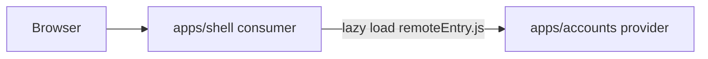

# open-banking-lite

Public, fictional retail-banking frontend. It shows how a client area behind login can be split into independently built microfrontends, composed by one shell. Every balance on screen is made up. Nothing here talks to a real bank.

## Idea

A retail bank’s signed-in experience is several products living in one window: accounts, payments, cards. Teams want to ship those products on their own schedule without rebuilding the whole site.

This repo is a reference for that shape. The shell owns the frame the customer sees (header, navigation, where a section appears). Each product is a microfrontend the shell loads at runtime. Later pieces — a shared design system, a NestJS backend-for-frontend, and a public marketing site — sit around that core. They are not in the workspace yet.

## Architecture

The signed-in area is a Vite + React single-page app inside an Nx monorepo. Login already happened before this UI matters, so the shell does not need server rendering. It fetches each section as a remote module when the page runs.



- `apps/shell` is the consumer. It renders the “Open Banking Lite” header and asks the federation runtime for `accounts/App`. The list of remotes lives in `apps/shell/src/mf.ts`, so adding another section is a runtime registration, not a rebuild of every app.
- `apps/accounts` is the provider. Its Vite config exposes `./App` as `remoteEntry.js`. The same app also opens on its own, which is how that team would develop the section without the shell.
- React and React DOM are shared singletons, so the shell and the remote use one copy.

Nx only runs the tasks. Module Federation (`@module-federation/vite`) is what connects the apps. `nx serve accounts` starts the provider and the shell together, because the accounts serve target depends on the shell.

| App | Role | Dev URL |
| --- | --- | --- |
| `apps/shell` | Consumer: frame and composition | http://127.0.0.1:5100 |
| `apps/accounts` | Provider: account list | http://127.0.0.1:5101 |

## What is on screen

Three fictional accounts: name, number, and balance. The list is static data inside the accounts app. There is no API.

## What comes later

- More providers for other client-area sections, registered the same way as accounts.
- A design-system library both apps import, so shared UI is a package rather than a copy.
- A NestJS backend-for-frontend that serves the mock API the microfrontends call.
- A separate public marketing site in Next.js. That surface is anonymous and benefits from server rendering; the signed-in panel stays on Vite.

## Run

```sh
pnpm install
pnpm exec nx serve accounts
```

Open the shell at http://127.0.0.1:5100. The account list is loaded from http://127.0.0.1:5101. Opening the accounts URL directly shows the same list without the shell.
